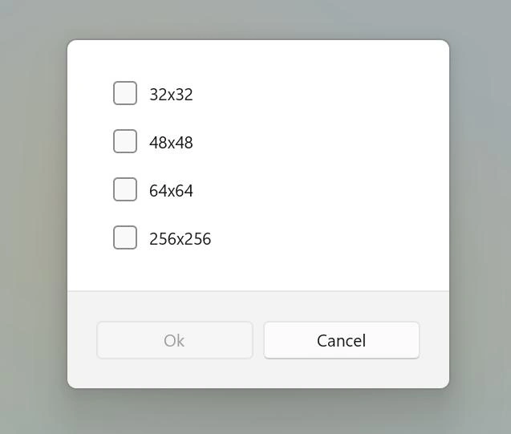
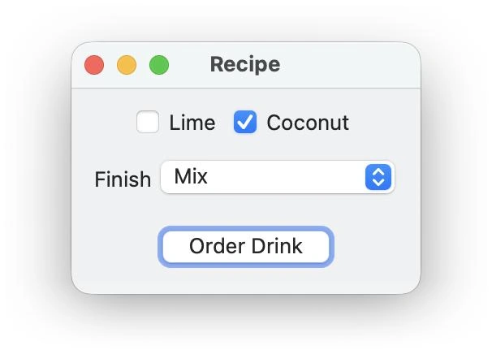
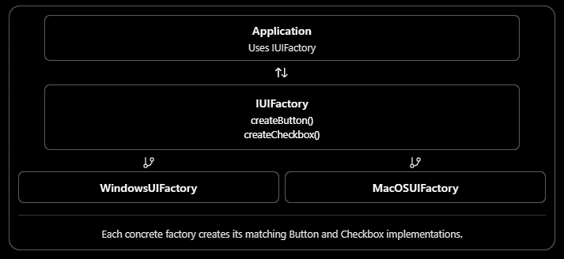

# Learning Exercise: Abstract Factory Design Pattern

Design Patterns

OOP

Intermediate

Problem: Build a Cross-Platform UI Component Factory

Estimated time: 30–45 minutes

## 1. Problem statement

You are developing a desktop application that must support multiple operating systems, such as Windows and macOS.

Each operating system has its own visual style for UI components. Your application needs to create buttons and
checkboxes that match the selected operating system.

For example:


Windows UI

Windows-style button and checkbox.



macOS UI

macOS-style button and checkbox.

Your task is to design a system that creates compatible UI components without coupling the application to concrete
component classes.

## 2. Requirements

Your implementation must satisfy these requirements:

1. The application must support Windows and macOS.
2. Each operating system must provide two component types:
    - `Button`
    - `Checkbox`
3. Components created by the same factory must belong to the same operating-system family.
4. The application must use interfaces or abstract classes instead of depending on concrete implementations.
5. Adding support for a new operating system, such as Linux, should require minimal changes to the existing application code.
6. The application should be able to render its UI without knowing which concrete factory created the components.

## 3. Expected behavior

For example, when the application is configured for Windows, the output might be:

```
Application started with Windows UI

Rendering Windows Button
Rendering Windows Checkbox
```

When configured for macOS:

```
Application started with macOS UI

Rendering macOS Button
Rendering macOS Checkbox
```

The application code that renders the components should remain unchanged.

## 4. Your tasks

Work through the following steps in order.

### Implementation checklist

1. Define the abstract products

- Create IButton and ICheckbox interfaces. Each should declare a render() method.

2. Implement concrete products

   - Create WindowsButton, WindowsCheckbox, MacOSButton, and MacOSCheckbox.

3. Define the abstract factory

   - Create an IUIFactory interface with createButton() and createCheckbox() methods.

4. Implement concrete factories

   - Create WindowsUIFactory and MacOSUIFactory, each returning its corresponding component family.

5. Implement the application

   - Make the application receive an IUIFactory through its constructor and render both components.

6. Test extensibility

   - Add a Linux factory and its components without modifying the application's rendering logic.

## 5. UML class diagram

Use this diagram as a design guide, not as a complete implementation.



Each concrete factory creates its matching Button and Checkbox implementations.

## 6. Constraints and hints

- Do not use `if/else` statements inside the application to choose between `WindowsButton` and `MacOSButton`.
- Do not instantiate concrete products directly inside the application.
- Use dependency injection to provide the factory.
- Keep the product interfaces independent of operating-system-specific implementations.
- Ensure a factory never accidentally returns products from different families.

Hint: The key idea is to abstract the creation of related objects, not merely the creation of one object.

## 7. Self-assessment questions

After completing the exercise, make sure you can answer these questions:

1. Why is this an Abstract Factory problem rather than a Factory Method problem?
2. What are the abstract products, concrete products, abstract factory, and concrete factories in this example?
3. What changes are required to add Linux support?
4. What happens if you need to add a new product type, such as a `Menu`?
5. Which SOLID principles does this design support, and what trade-offs does it introduce?

## A Trade-off
The main trade-off of Abstract Factory is that adding a new product family is easy, but adding a new kind of
product affects the factory interface and all concrete factories.
